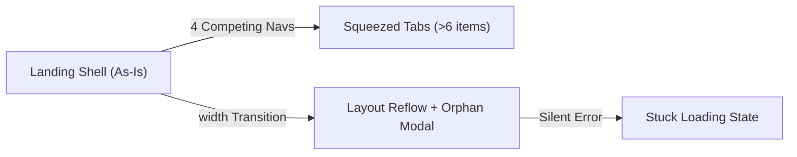
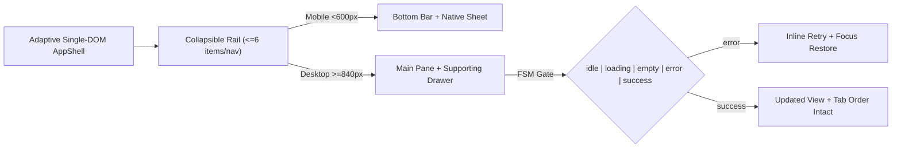

# 7-Section CLAREZA Deliverable & Navigation Before/After Patterns

Every Stage 0 audit emits a structured **7-Section CLAREZA** report (`As-Is` diagnosis + `To-Be` plan) with actionable handoff inputs for `ui-brand-ux-planner`.

## 1. Mandatory 7-Section CLAREZA Output Structure
1. **Token & Polarity Inventory:** Observed colors, `oklch()` / `light-dark()` ratio, detected `#000000` / `C > 0.22` neon breaches, `color-mix(in oklch)` gamut warnings, and 5-Plane surface gaps.
2. **Typography & Stitch Spacing Matrix:** Loaded fonts, `text-rendering` placement (`auto` body vs `optimizeLegibility` headings), `clamp()` / `65ch` discipline, and off-grid spacing literals.
3. **12-Vector Anti-AI-Slop & Icon Craft Ledger:** Computed `ai_slop_score`, blur blobs, confetti badges, dashed wireframes, reflow animations, tab-order breaks, amateur `<svg>` clouds, mixed icon packages, and files exceeding `600` lines.
4. **Chrome DevTools & CWV Telemetry Probe:** `CSS Overview` findings, `Issues`, `Performance Monitor` DOM/heap counts, INP (`ms`), LCP (`s`), CLS, horizontal overflow, and `dashedWireframeCount`.
5. **Navigation Friction Matrix:** Sprawl (`> 6` primary tabs or `> 3` `<nav>` landmarks), orphan modals, cramped buttons (`< 44px` / `< 48px` coarse), unguarded state transitions, and >3-click dead ends.
6. **`As-Is` & `To-Be` Mermaid Navigation Flows:** Visual comparison of fragmented routes vs unified Single-DOM adaptive postures (`Compact` / `Medium` / `Expanded`). Always quote Mermaid labels containing parentheses or brackets (`id["Label (Info)"]`).
7. **Prioritized Before/After Refactor Matrix:** Concrete `[Component / Metric | Current (As-Is) | Proposed Target (To-Be) | Owner Skill]` rows.

## 2. Adaptive Single-DOM Navigation Limits & Canonical Mermaid Flows

| Dimension | Failing `As-Is` Pattern (`[FAIL]`) | Clean `To-Be` Pattern (`[PASS]`) |
| :--- | :--- | :--- |
| **Landmarks & Slots** | `> 3 <nav>` wrappers or `> 6` squeezed top tabs (`overflow-x: hidden`). | `<= 3 <nav>` containers (`<= 6` items each) + horizontal `scroll-snap` tabs with `mask-image` edge fade. |
| **Mobile Posture** | Compressed desktop sidebar overflowing `360px` viewports. | Adaptive Single-DOM: Bottom Bar (`env(safe-area-inset-bottom)`) `< 600px`, Rail `600–839px`, Collapsible Sidebar `>= 840px`. |
| **Expandables** | Instant JS toggle losing keyboard focus or animating `height`/`width`. | `0fr -> 1fr` grid accordions, native `
`, and `popover="auto"` with `@starting-style` + `allow-discrete`. |

### `As-Is` Anti-Pattern (Dead Ends & Competing Navs)

### `To-Be` Clean Adaptive Single-DOM Pattern

