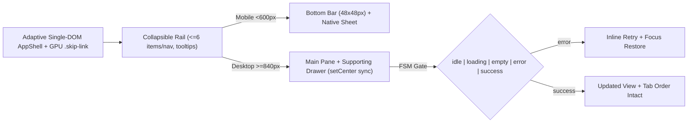

# Intent-First Audit, Root/Canvas Checklist & 7-Section CLAREZA Patterns

Every Stage 0 audit begins with `[CoT-0]` Intent-First locking and emits a causal **7-Section CLAREZA** report (`As-Is` diagnosis + `To-Be` plan) for `ui-brand-ux-planner`.

## 1. `[CoT-0]` Intent-First Modes, Root Hygiene & Stack Diagnosis
- **Invocation Modes:** `pre-plan` (audit before architecture), `planner-directed` (1-hop `ScopedAuditRequest` from `ui-planner` returning `CLAREZA_DELTA`), or `plan-brief` (compile structured evidence to seed a plan). If an interactive prompt omits both target and goal, ask; on concrete `<target>` invocations, infer `intent: "baseline_forensic_audit"` (`intent_inferred: true`).
- **Advisory Root & Topology Check (`root_hygiene_warnings`):** Inspect `package.json` scripts (`dev`, `build`, `lint`, `test`), single lockfile (`package-lock.json` vs `pnpm-lock.yaml` vs `yarn.lock` vs `bun.lock*`), `tsconfig.json` (`strict: true`, JSONC/`references`/`extends` aware), governance docs (`README.md`, `.context/`), `.gitignore`, folder tier (`1` flat CSS / `2` Feature SPA / `3` App Router `(group)/` + `_components/`), and mixed frontend stacks (e.g., `reactflow` + `@xyflow/react`, `bootstrap` + `tailwindcss`, v3 `tailwind.config.*` + v4 `@import`). Defer backend parity to `system-project-auditor`.

## 2. Mandatory 7-Section CLAREZA Output Structure & Epistemic Tags
Tag every finding `[OBSERVED FACT]`, `[TECHNICAL INFERENCE]`, or `[GAP]`, linking **`Friction X -> Consequence Y`**:
1. **Token, Warning & Polarity Inventory:** `oklch()`/`light-dark()` coverage, 3-layer token assembly, Light vs. Dark shadows, warning/alert contrast, `#000000`/`C > 0.22` breaches, and text-on-token legibility.
2. **Typography & Spacing Matrix:** Loaded fonts per page, `text-rendering` (`auto` body vs `optimizeLegibility` headings), `clamp()`/`60-65ch`, `flow-root`, and macro Grid vs `@container` micro coupling.
3. **Anti-AI-Slop, AppSec & Icon Craft Ledger:** `ai_slop_score`, blobs/confetti/wireframes/gradient-text/side-stripes, `AUDIT-SEC-ENV-LEAK` (redacted `NEXT_PUBLIC_*`/`VITE_*` secrets), `AUDIT-SEC-01` (HTML/`eval` sinks), `AUDIT-STUB-PLACEHOLDER`, mixed icon packs, and `> 600`-line splits.
4. **Chrome DevTools & CWV Telemetry Probe:** `CSS Overview`, `Issues`, `Performance Monitor` DOM/heap counts, `wrappedNavItems`, `mysteryIconOnlyNavCount`, `gradientTextCount`, `skipLinkPresent`, INP (`<= 200ms`), LCP (`<= 2.5s`), CLS.
5. **Menu Label Audit & Canvas Capability Matrix:** Count `<nav>`/`<ol>`/`role="tab"` items, decode label lengths (`<= 26` chars; flag raw `/` in HTML breadcrumbs vs CSS `::before`), and audit infinite canvas features (drag, resize, vector edges/arrows, pin, sticky notes, `useReactFlow().setCenter()`, Windows `\`->`/` watcher normalization).
6. **`As-Is` & `To-Be` Mermaid Navigation Flows:** Visual comparison of fragmented routes vs Single-DOM adaptive postures (`Compact` / `Medium` / `Expanded`) + GPU `.skip-link`. Always quote Mermaid labels containing parentheses/brackets (`id["Label (Info)"]`).
7. **Causal Before/After Matrix:** `[Component / Metric | Friction X (As-Is) | Consequence Y | Target (To-Be) | Owner Skill]`.

## 3. Menu Ergonomics & Interactive Canvas Audit Reference
| Dimension | Failing `As-Is` Pattern (`[FAIL]`) | Clean `To-Be` Pattern (`[PASS]`) |
| :--- | :--- | :--- |
| **Landmarks & Skip** | `> 3 <nav>`, repeated `"navigation"` in `aria-label`, no skip link, raw `/` in HTML. | `<= 3 <nav>` (`<= 6` concise items), unique `aria-label`, GPU `.skip-link`, `<ol role="list">` + CSS `::before`. |
| **Labels & Mobile** | Unwrapped `> 26`-char desktop menu labels, compressed sidebar at `360px`, mystery icon rails. | Concise 1-word mobile labels (`4–8` chars), `48x48px` Bottom Bar `< 600px`, tooltip on collapsed rails. |
| **Canvas Controls** | Static nodes lacking drag/resize/edges/notes, `nodeTypes` inside render, disconnected log panel. | Memoized nodes, hoisted `nodeTypes`, Dagre `TB/LR`, predictive `setCenter(x, y)`, Windows `/` path clean. |

